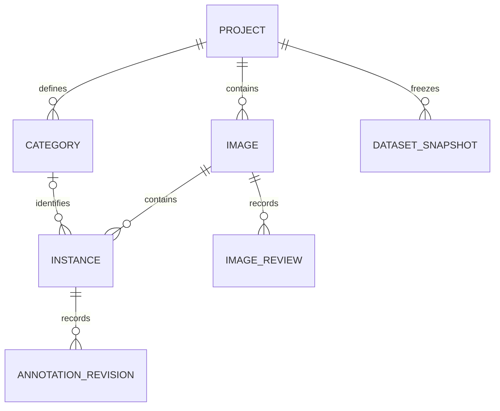
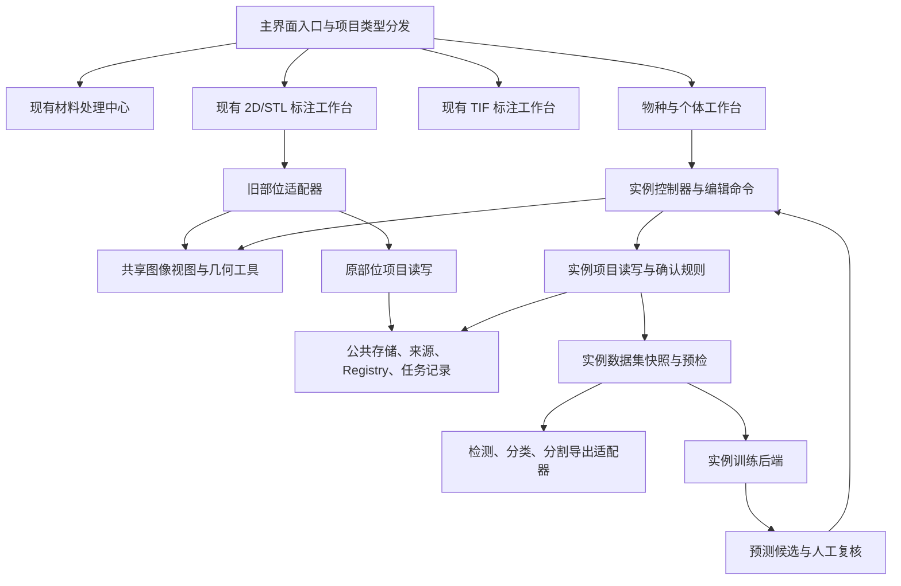

# 多物种、多个体标注工作台设计稿

设计版本：0.3  
日期：2026-11-02  
状态：一期功能已在本地开发工作区实现，正在形成验收基线；本稿保留设计提案与验收目标，不能据此认定全部细节已通过。实际实现、差异和验证范围见[实现与验证记录](../validation/instance_workbench_validation_zh.md)，操作见[使用说明](../instance_workbench_zh.md)。外部模型和智能体最终契约见 `docs/contracts/instance_*_contract_zh.md`。

## 1. 要解决的研究任务

在一张照片中框出多只个体，为每只个体指定物种；同种可以出现多只，不同种可以同时出现。研究者无需建立头部、胸部、腹部或性状树，即可形成用于物种检测、单体图像分类以及实例分割的数据集。

典型例子：照片中有 5 只蚂蚁，其中 3 只属于类别 A、2 只属于类别 B。保存的是 5 条独立个体标注、2 个物种类别，而不是 2 个标注，也不是整图的一个物种名。类别 A/B 为示例标签，不代表真实鉴定结果。

根据用户确认的入口组织方式，在应用主界面新增“物种与个体标注”独立入口，与现有材料处理中心、2D/STL 标注、TIF 标注入口并列。沿用现有工作台名称与组织方式，新入口进入独立页面。共用底层图像操作、可靠保存、来源追溯和任务管理；分别管理各自的标注语义。第一批真实验收继续以蚂蚁材料为主，数据结构不写死蚂蚁部位；尚未验证的其他类群不作为产品有效性承诺。

### 1.1 三种训练目标必须分清

| 研究者希望模型做什么 | 所需标注 | 本设计安排 |
| --- | --- | --- |
| 在整张照片里找到每只个体并识别物种 | 每个个体的矩形框和物种类别 | 一期提供：目标检测 |
| 输入一张单体照片，识别物种 | 单体图像和物种类别 | 一期从已确认个体框裁剪导出分类数据；支持明确声明的整图单体标注 |
| 区分每只个体占据的精确像素 | 每个个体的独立掩膜和物种类别 | 一期提供：SAM/手动轮廓与实例分割 |

框出同种的三只个体必须得到三个对象。SAM 只能辅助确定轮廓，不能据此证明物种身份。不能把多物种整图复制到多个单标签分类目录，制造互相矛盾的分类样本。

### 1.2 一期完整交付范围

按用户要求一次交付可用的完整工作台，不再划分三期。开发按依赖顺序推进，交付须同时完成以下内容：

- 独立入口、新建/打开、图片与材料导入、物种类别及多个体管理。
- 手动画框、多边形编辑、SAM 点选/框选描边、轮廓修正、实例掩膜保存、撤销重做。
- 自动保存、备份恢复、逐个/批量确认、整图完整性检查、候选复核及筛选队列。
- COCO 检测/实例分割和 YOLO 检测/分割导入导出、单体分类目录导出与导入、来源分组和数据集预检；不能无损转换的格式明确阻止或要求用户选择有记录的转换。
- 检测、分类、实例分割三个任务的训练/预测适配，复用模型管理、设备设置、训练记录及权重登记；完成小数据技术闭环测试，不把占位训练按钮算作完成。
- 材料处理中心到新工作台的明确目标选择，Agent Center 正确上下文与能力声明，现有工作台回归验证。

视频追踪、三维多个体、CT 体分割、团队在线协作、跨图自动重识别及完整命名法规数据库不属于本次工作台任务。框选个体与跨图确认同一标本是两件事。主动学习在本次指按已有置信度/未审核状态筛选待复核对象，不额外建立新的采样算法平台。

## 2. 现有实现调查与复用判断

以下为已阅读源码得到的结论；文件名为仓库相对路径。

| 现有位置 | 现状与限制 | 设计处理 |
| --- | --- | --- |
| `AntSleap/core/project_templates.py` | 已有 generic 模板，但 taxonomy 是 Object/Region/Structure 等结构类别 | 模板与任务类型分开；新增模板不能替代实例模型 |
| `AntSleap/core/project.py` | `labels[image_path].parts`、boxes 以部位名为键；已有图像级 taxon 信息 | 保留旧读写语义；新个体以稳定 ID 为键，类别另设外键 |
| `AntSleap/core/project_sqlite_schema.py` | `label_parts` 存在 `UNIQUE(label_id, part_name)`；images 已有 image_uid | 复用图像身份机制，新增独立实例 schema；不把物种名塞进 part_name |
| `AntSleap/ui/canvas.py` | 缩放、平移、框、多边形已有实现；状态、信号、历史与 part 绑定 | 抽出图像视图和几何编辑能力，旧部位与新实例分别使用适配器 |
| `AntSleap/ui/main_window_annotation.py` | 工具切换与 SAM 可参考，但包含 Blink 上下文和父部位框比例约束 | 新工作台用独立控制器；默认自由矩形，不继承部位比例锁 |
| `AntSleap/ui/main_window_coordinator.py`、`main_window_start_center.py` | 已有工作台进入、返回和项目保护 | 扩充模式路由，打开项目时先识别类型再创建页面 |
| `AntSleap/core/training_truth.py` | 现有可信度记录按部位管理，区分来源和确认状态 | 复用真值原则，新增实例级接口，不能直接调用按部位写入函数 |
| `AntSleap/core/project_training_inputs.py`、`training_run_2d.py` | 已有不可变训练输入与校验；采样和准备结构依赖 parts、locator_scope | 复用底层 Registry/运行记录，新增实例数据解析与训练准备器 |
| `AntSleap/core/external_backend.py` | v1 预测用类别名到框/多边形的字典，训练调用现有部位准备器 | 新增版本化实例契约；旧转换器会限制同类多个对象，禁止复用其数据形状 |
| `AntSleap/ui/main_window_export.py`、`project.py` 的 export 方法 | 已有后台导出与过期结果隔离，导出类别语义来自现有 taxonomy | 复用任务框架，新增实例导出器与物种类别映射 |
| `AntSleap/core/sqlite_storage.py`、`project_traceability.py` | 已有 SQLite、迁移、稳定身份与项目数据版本 | 复用基础设施；新项目类型须显式扩展身份和打开分发 |

**结论**：不能仅重命名侧栏，也不应复制整个 MainWindow 或整个 ProjectManager。先把图像交互等无部位含义的能力抽出，再通过适配器保护旧流程。已有“通用导出”测试只能证明其原有结构类别协议，不能证明多个体已受支持。

本次补查发现：`AntSleap/core/sam_helper.py` 已有 SAMWorker、模型加载、设备选择、点/框提示和权重身份校验，可直接作为推理基础；但 `mask_generated` 返回单条多边形，`_process_results` 从候选轮廓中选择一条。新实例路径需返回原始掩膜与请求上下文，保留旧信号兼容，不能把现有单轮廓输出误称为含孔洞/多区域的无损结果。`AntSleap/core/dataset.py` 的 TwoStageDataset 按部位生成一组宽高目标，不是现成的同类多目标训练数据集。

架构约束：复用现有 SQLite 连接、事务、迁移、备份、Registry、模型运行与工作台组织规范，仅新增实例业务表和必要适配器；不重建存储引擎、任务平台或模型设置系统。下面的模块划分表示职责边界，不要求每项都建一个新框架或预先大规模重构旧工作台。

## 3. 工作台与操作设计

### 3.1 入口

主界面新增“物种与个体标注”入口卡片，保持与现有独立工作台一致的进入方式：

```text
TaxaMask 主界面
├─ 材料处理中心          → 现有材料处理流程
├─ 2D/STL 标注           → 现有部位与性状标注工作台
├─ TIF 标注              → 现有体数据标注工作台（遵循已有可见性设置）
└─ 物种与个体标注〔新增〕→ 独立多个体工作台
```

新增卡片说明：“标注图片中的多个个体及其物种，用于识别模型的数据准备与训练。”提供“进入工作台”和“新建项目”；有该类型已打开项目时，进入按钮显示返回该项目。没有项目时提供新建/打开选择，不借用现有 2D 项目作为隐式默认项目。

主导航采用“主界面入口 → 独立工作台 → 返回主界面”，不在现有 2D/STL 标注页面增加物种/部位模式切换开关。保持现有入口名称；“形态与部位”在本文中是对现有工作台职责的描述，不是重命名要求。新增入口复用 `_build_workflow_card` 的视觉与交互规范；四入口在窄窗口下需要换行或滚动，避免按钮挤出可见范围。

新建向导依次选择：项目位置 → 类别表（可稍后填写）→ 图片来源 → 默认任务“多个体检测”。单体分类是同一实例工作台的简化录入方式。“打开任意项目”“继续上次项目”和最近项目列表同样按项目类型进入正确工作台；新实例项目使用独立当前项目上下文，不复用旧 `self.project` 中的部位状态。

任务类型保存在项目中，不以当前侧栏选择推断。切换工作台需要完成当前保存；保存失败停留原项目并显示原因。异步结果必须匹配项目 ID、图像 ID、实例 ID、请求时修订号，才可以更新当前内容。

### 3.2 主页面线框稿

```text
┌ 项目：蚂蚁物种数据集  [物种与个体]  [导入] [撤销/重做] [导出] [训练/预测] ┐
│ 图片与筛选          │ 工具：选择 | 框 | 多边形 | SAM 点/框 | 修补             │ 类别与个体       │
│ 搜索 / 来源组       │                                              │ 类别搜索         │
│ 全部/待标/待复核    │      ┌ A · #01 ┐        ┌ A · #02 ┐          │ ● 类别 A   3     │
│ 已完整检查/有问题   │      │ 个体 1  │        │ 个体 2  │          │ ● 类别 B   2     │
│                    │      └─────────┘        └─────────┘          │ ＋新增类别       │
│ image_001   待复核  │               ┌ B · #04 ┐                    │─────────────────│
│ image_002   未开始  │               │ 个体 4  │                    │ 当前图：5 个体   │
│ image_003   已检查  │               └─────────┘                    │ #01 A  已确认    │
│                    │                                              │ #02 A  待确认    │
│                    │                                              │ #04 B  已确认    │
│                    │                                              │ [改类][删除]     │
│                    │                                              │ [确认选中个体]   │
├ 当前图 1/300 · 已确认 4/5 · 整图未检查 · 已保存 ──────────────────────┤
│ [上一张] [下一张]   [本图已完整检查] [确认无目标] [暂不用于训练]       │
└─────────────────────────────────────────────────────────────────────┘
```

图中框仅示意布局，不是算法效果；框、轮廓、SAM、训练和预测均为本次交付入口。提供框/轮廓显示切换、透明度与实例编号设置。窄窗口可折叠左右栏，保留当前类别、选中个体和保存状态。

### 3.3 最短标注路径

1. 导入照片，搜索或创建类别 A。
2. 连续画三个框，产生三个独立 ID；默认沿用上次类别，画完即可继续画下一个。
3. 切换类别 B 再画两个框；类别切换只影响新框，不改已有标注。
4. 点击画面或个体列表可双向定位。重叠框支持循环选择；显示序号可变，实例 ID 不变。
5. 检查后确认选中个体；确认动作覆盖“框的位置”和“物种标签”。人工新画框也先保存为待确认，避免把误操作直接当作训练真值。
6. 确认本图所有目标均已处理后，点击“本图已完整检查”。自动保存与是否可训练分别显示。
7. 导出前查看每类数量、排除原因、训练/验证/测试分组，再生成数据集。

建议快捷键 B 画框、V 选择、Space 平移、Delete 删除、Ctrl+Z 撤销；键位需与现有窗口实测避冲突，文本输入有焦点时不触发画布快捷键。批量确认显示对象数和作用范围；不能用“确认选中”暗中确认整图。

### 3.4 类别和标本信息

- 类别以稳定 category_id 标识；学名、中文名、别名、颜色是可修改属性，不是主键。类别排序不改变历史训练类别编号。
- 支持暂定形态种，如“Formica sp. A”；记录 identification_status 为 provisional，不将其伪装成正式物种鉴定。
- 未鉴定对象保留 category_id 为空及备注；不默认建立一个混杂的“unknown 物种”训练类别。属级确认不能自动成为种级样本。
- 类别更名保留 ID；合并必须预览影响数量、保留历史别名和事件；已有引用类别只能停用或显式重新映射，不能静默删除。拆分类别须逐对象重新审核。
- instance_id 表示一张图里的一个可见对象；specimen_id 是可选的真实标本标识。同一标本的正面、侧面照分别有 instance_id，通过 specimen_id 关联。
- 对象属性可选记录遮挡、截断、鉴定备注。首期不强制填写部位、性状、阶级或性别；这些未来可作为属性，不能与物种类别混为一谈。

### 3.5 SAM 描边与轮廓编辑（一期必需）

1. 选中物种后，可用“新建个体”点选或框选 SAM 描边；修改已有个体则先选中该实例，再进入“重描轮廓”。两种操作必须明确区分，防止每次描边覆盖上一只同种个体。
2. **提示框仅用于 SAM 推理**，不直接成为检测真值框。手动画的标注框可独立保留；有掩膜时默认从有效掩膜计算紧致框，显式人工框必须包围掩膜，否则要求修正或选择使用掩膜框。记录框来源，不静默用较松提示框替换真值。
3. 推理结果先显示候选预览，提供“采用”“重试”“取消”。已有确认轮廓保持到采用新结果时，再创建待确认修订；失败、空结果、取消均不清空旧标注。新建请求先使用独立 request_id，采用时分配实例 ID，取消不留下幽灵实例。
4. 复用现有多边形顶点移动、增删点、撤销重做；提供掩膜画笔/橡皮修补以及区域保留/删除，使断开的足、触角和孔洞不因转成单轮廓而消失。编辑后的掩膜作为几何真源，显示轮廓由其派生；纯多边形编辑生成新掩膜修订。禁止两个版本各自可写却未同步。
5. 一次提示默认针对一只个体；轮廓包含相邻个体时允许继续修正或重做，不自动确认物种，也不根据同色合并实例。遮挡只标可见区域，不推测隐藏身体；不同实例可有重叠框。
6. 复用 SAM 权重选择、计算设备、加载状态与误差提示。GPU 任务统一排队，避免两个工作台各自无约束加载模型；模型缓存按权重身份和设备区分，图片特征缓存按图像指纹区分，切图不串用。
7. 补充统一多点提示接口以支持前景/背景点修正；现有接口只证明单正点和框提示可用，多点能力需要新适配及测试，不能宣称已复用现成功能。SAM 不可用时保留手动标注，清晰显示原因和模型设置入口。

### 3.6 导入、批量操作与材料衔接

- 图片支持文件、多选与文件夹导入；复用现有可解码格式校验，坏图逐项报告。显式选择复制或引用源图，默认复制便于项目搬迁；大量材料可选引用。检查体数据 TIFF，不能把三维 stack 隐式作为单张照片导入。
- 标准标注导入先预览类别映射、图像匹配、对象数、坐标及冲突。COCO 支持 bbox、polygon、RLE；YOLO 必须明确检测或分割格式；分类目录每图只生成一个全图候选实例。没有标注文件不等于负样本；导入标签均待确认。
- 同批重复导入通过来源批次、外部对象 ID、图像指纹检测，用户选择跳过或作为新修订；不只凭类别或几何相近判断同一个体。导入按事务提交并生成报告，失败不留下半批正式对象。
- 批量改类、确认、删除只作用于明确选择集，预览数量和影响，可撤销；筛选支持物种、来源、确认状态、几何类型及置信度。显示当前图和全项目统计口径，暂时隐藏的对象仍参与完整性检查。
- 材料中心导入时选择目标项目/工作台，沿用 material intake 注册与已有导入许可边界；不自动把现有所有材料页开放导入。图版说明和文献物种名作为来源/类别建议，不自动赋给图中所有对象。保存页码、图版编号、裁剪变换和来源链接。
- Agent Center 可读取新工作台上下文并解释/定位待复核内容；仅注册已实现的实例服务动作，未适配旧部位命令须明确拒绝，不能落到旧项目上执行。

## 4. 数据模型与持久化

### 4.1 架构决策

新增独立项目类型 `species_instances_2d`（拟定名称），拥有独立 schema 版本和实例 repository。沿用 manifest + SQLite 的存储思路以及公共图像/来源概念；不把新对象追加到旧 labels 字典并让旧保存器负责保存。

首期新旧项目是不同项目文件，不支持在一个旧项目中即时切换并改写语义。新类型的 manifest 应采用明确的版本/能力门禁，先于读写器分发校验。必须用真实旧版打开实验验证拒绝行为，不能仅假设增加一个 project_type 就能防止旧版误写；若旧加载器忽略类型，则采用不被旧版识别的新入口扩展名和 manifest 版本。新格式在完成兼容测试前不冻结。



### 4.2 拟定实体与约束

| 实体 | 关键字段 | 必须满足的规则 |
| --- | --- | --- |
| project | project_id、project_kind、schema_version、data_version_id、target_rank、annotation_scope | 训练目标层级与“哪些对象算目标”显式记录 |
| image | image_uid、source_uri、fingerprint、width、height、orientation_transform、source_group_id | 同名文件不等于同图；路径可迁移，身份保持 |
| category | category_id、display_name、scientific_name、taxon_rank、identification_status、aliases、active | ID 稳定；更名不改引用；暂定名可用但必须声明 |
| instance | instance_id、image_uid、category_id、bbox_xyxy、geometry_kind、mask_ref、specimen_id、attributes、revision | 同图同类任意多个；类别不参与唯一约束 |
| annotation_revision | instance_id、revision、geometry_source、class_source、review_status、accepted_via、reviewed_revision、model_ref、time | 位置和类别来源分别记录；确认只适用于该修订 |
| image_review | image_uid、status、reviewed_image_revision、scope_version | 完整性覆盖整张图和该次标注范围 |
| annotation_event | event_id、entity_id、operation、before_revision、after_revision、transaction_id | 支持修改、删除、撤销与恢复追溯 |
| dataset_snapshot | snapshot_id、input_hashes、category_map、partition_map、policy、exporter_version | 导出与训练只读同一个冻结快照 |

所有名称和字段均为实施建议，不是已发布 API。仅画框时 mask_ref 为空；轮廓实例必须关联当前修订的有效掩膜及指纹。

坐标统一为方向校正后图像上的像素浮点数、左上原点、框 `[x1,y1,x2,y2]`，满足 `0 ≤ x1 < x2 ≤ width`、`0 ≤ y1 < y2 ≤ height`。导出时显式转换为 COCO xywh 或 YOLO 归一化中心/宽高。显示缩放不能写回坐标。EXIF 旋转、导出图像和标注必须使用同一方向；原图不覆盖，转换关系写入来源记录。

掩膜允许一个实例由多个不相连区域构成，内部不强制单多边形；含孔洞使用可无损表示的掩膜/RLE。旋转框不在本次范围内，不把轴对齐框冒充旋转框。

### 4.3 保存和恢复

实例变更、修订、整图状态失效和事件日志在同一数据库事务中提交。UI 仅在事务成功后显示“已保存”；失败保留未保存编辑并提供重试/另存恢复副本。图像导航前提交当前编辑，禁止将未提交对象写入下一张图。

复用现有原子写入、备份、迁移和 Registry 底层工具，但必须增加新实体快照物化器及恢复校验。撤销/重做用领域命令覆盖几何、类别、删除和确认状态，不能只恢复画布框。删除留审计记录；恢复旧文件不自动恢复为可训练真值，必须检查恢复内容与确认修订是否相符。

缩略图分页/延迟加载，保存仅提交变化的对象，打开项目不把全部原图解码到内存。掩膜文件按对象修订存储并校验，清理不能删除已被训练快照引用的资源。多进程同时写同一项目首期采用单写者锁并给出明确提示。

## 5. 确认、漏标与训练资格

两个状态轴必须分别展示：**对象是否正确**与**整图是否检查完整**。一张图确认了两只个体，仍可能漏掉第三只；将漏标区域当背景会损害检测模型。

### 5.1 状态转换

- 对象：新建/导入/AI 建议 → `draft`；人工确认当前修订 → `confirmed`；修改框、类别或掩膜 → 新修订且回到 `draft`。删除后不参与导出。置信度不能替代人工确认。
- 整图：`unreviewed` → `in_progress` → `complete`；明确检查无目标时为 `confirmed_empty`。对象变化、图像内容变化或标注范围变化都会使整图完整确认失效。纯显示色变化不使几何审核失效。
- `excluded` 表示暂不用于训练，不等于负样本。无任何标注也不等于 `confirmed_empty`。
- AI 建议保存在候选层，人工已确认内容不会被新预测覆盖；接受某条建议后才写入正式实例修订。拒绝建议留可追溯记录。

### 5.2 默认导出资格

| 情况 | 检测/实例分割 | 单体分类 |
| --- | --- | --- |
| 个体均确认，整图已完整检查 | 可进入；分割另要求有效掩膜 | 可按个体裁剪 |
| 个体已确认，整图未检查完整 | 整图排除，避免漏标背景 | 该个体可进入，但仍检查裁剪纯度 |
| 确认无目标 | 可作为负样本；记录检查范围 | 不产生类别样本 |
| 有未鉴定目标、未解决候选或人群式密集目标 | 默认排除整图；后续支持后端明确认可的 ignore 区域 | 已确认且能独立裁剪的个体可进入 |
| AI 草稿、导入未审核、损坏或缺失图像 | 不进入正式训练集 | 不进入正式训练集 |

整图完整检查入口会列出未确认对象、未知类别、无效几何等阻断项。后台资格校验必须再次检查，不能仅信任界面按钮状态。目标范围之外的物体可以按明确任务定义作为背景；范围内却不能鉴定的个体不能默认当背景。

本工作台不更改旧项目 `manual_truth` 的含义。新实例确认记录通过专门的可信度解析器使用，导出报告记录采用的规则版本。人工确认表示研究者确认了该标注，不是软件证明其生物学正确。

## 6. 可复用架构与模块边界



### 6.1 拟定新增模块

| 模块组 | 责任 |
| --- | --- |
| `core/instance_annotations.py` | 实体、几何校验、稳定 ID、领域命令数据 |
| `core/instance_project.py`、`instance_sqlite_schema.py` | 新项目生命周期、事务、加载与迁移 |
| `core/instance_truth.py` | 按实例修订确认、整图完整性、任务资格 |
| `services/instance_annotation_service.py` | 新建、编辑、改类、删除、确认与撤销命令 |
| `ui/instance_workbench.py`、`instance_workbench_controller.py` | 页面组合、选择联动、图片导航和项目切换 |
| `ui/instance_list_model.py`、`category_list_model.py` | Qt 列表模型，筛选与增量刷新 |
| `ui/annotation_viewport.py`、`annotation_geometry_tools.py` | 从原画布抽出的坐标变换、视图和几何操作；不依赖物种或部位 |
| `core/instance_dataset_snapshot.py`、`instance_dataset_export.py` | 冻结输入、分组、预检、格式导出和裁剪来源 |
| `core/instance_training.py`、`instance_backend_contract.py` | 新训练准备器、实例预测协议、模型兼容检查 |

公共接口按需要提取，不建立泛化插件框架。模型下载/设置、SAM 推理服务、来源记录、训练运行账本可以复用；Blink 部位路由、父子部位继承、部位专属比例、现有 locator 采样逻辑不能直接复用。

### 6.2 画布适配协议

渲染项使用 `render_id`、`geometry`、`style`、`caption`、`selected`，不把显示文本当对象身份。编辑事件返回 render_id 与几何；旧适配器映射到 part，新适配器映射到 instance_id。历史由各领域命令管理，画布只保留当前拖拽的临时状态。

抽取前先固定旧画布行为测试；逐步移出坐标变换、底图显示、框编辑。不得在原 canvas 中散布大量 `if species_mode`，也不得用“物种名#1”伪造部位键。

## 7. 数据集、训练与预测契约

### 7.1 导出格式

- COCO 检测：一张图一个 image、一只个体一个 annotation、每物种一个 category；框标注不伪造 segmentation。annotation 保留稳定身份映射，数值 ID 在该快照内确定。
- YOLO 检测：同图可以有多行相同 class index；标签和图像按 image_uid 命名，避免不同文件夹同名覆盖；无目标图输出有效空标签并进入报告。
- 分类：一只已确认个体一张 crop。目录使用稳定安全类别键，显示学名单独写入类别映射；整图单体模式产生一个覆盖全图的显式实例，并要求研究者确认仅有该目标个体。若裁剪含其他个体或不能支持可靠鉴定，排除或进入复核队列。
- COCO 实例分割本次提供；只有实际已确认掩膜才能进入分割数据，矩形框不得自动填充成真值掩膜。
- 标准格式通常不携带全部来源与确认记录，因此附带本地 sidecar；重新导入不能仅因有标签就恢复为人工真值。

- YOLO 分割仅输出该后端支持的多边形。含孔洞/多区域掩膜默认转用 COCO RLE；若选择有损简化，须预览差异、记录规则并重新确认派生标签，不能静默丢孔洞或把多个区域变成多个个体。
- 同图混有框标注与掩膜标注时，检测可使用已确认的框；分割默认排除整张不完整图，不能只导出有掩膜的对象并将其余已知个体当背景。报告分开统计检测资格与分割资格。

### 7.1.1 三任务输入与评估

| 任务 | 快照输入 | 预测候选 | 技术验证与结果展示 |
| --- | --- | --- | --- |
| 检测 | 整图、多个实例框、类别索引 | 每只个体的框、类别、置信度 | 框 AP/召回及每类覆盖；同类多个目标均保留 |
| 分类 | 单体 crop、单一类别、原实例 ID | 绑定该 crop/实例的类别概率 | 每类 precision/recall、混淆矩阵；不把分类结果当整图定位结果 |
| 实例分割 | 整图、所有目标的独立掩膜、类别索引 | 多个独立掩膜及类别 | mask AP 与每类覆盖；不能用检测框指标替代分割指标 |

三任务共用固定来源划分。测试集保持独立，调参使用验证集；样本不足时显示无法可靠评估，不编造数值。训练界面提供任务、权重、图像尺寸、批大小、轮次、设备、开始/取消、日志与输出入口；默认参数从已验证后端配置读取，记录最终有效值。取消和失败记录到同一运行账本；仅在后端支持并校验输入快照一致时恢复训练。CPU 可用于小样本技术验证，实际耗时单独记录。

### 7.2 划分防止“看过答案”

先确定来源关联组，再划分，再裁剪。相同 specimen_id、同源图及派生裁剪、同一采集组、同一文献图版按关联关系合并成不可拆分组；同一图片中的多个标本会连接这些组。不能分别随机切分每个框。检查内容哈希重复，近重复作为人工复核提示。

建议初始比例 80/10/10，使用固定种子并保存最终分组；比例只作目标，不打散来源组凑数。每类样本或来源组不足时报告实际覆盖，不能偷偷复制样本填充验证/测试集。可明确选择 train/val 两份；没有独立测试集时不能报告独立测试效果。来源信息缺失则标记防泄漏检查不充分。

### 7.3 训练后端

新增能力声明 `task=detection|classification|instance_segmentation`、契约版本、输入格式、类别映射哈希、预处理要求和权重架构信息。优先核查已使用的 Ultralytics 运行依赖，按检测、分类、实例分割分别接入任务适配器，共用训练进程/记录和设置。最终模型系列与版本在实现时按已安装依赖、许可证及 Windows/PyTorch 兼容性验证并固定，不另建后端平台；三种任务均需技术闭环验收。已有 SAM 依赖不等于这三个训练适配已实现。

现有 Locator/SAM 和 Blink 权重不直接声明为物种识别权重。类数相同也不代表类别顺序相同，权重加载必须校验类别映射与任务类型。训练使用已冻结实例快照，不在启动后读取正在编辑的项目标签。

复用 TrainingRunRecorder、输入指纹校验、运行账本和权重发布机制，但新增实例样本解析器、Registry 标签 schema/确认样本物化器以及前置校验；不能调用旧 prepare_2d_training_run 后改一个名称冒充新训练任务。

### 7.4 预测返回结构（示意）

```json
{
  "schema_version": "taxamask_instance_prediction_v1",
  "task": "detection",
  "image_uid": "image_demo",
  "category_map_hash": "sha256:EXAMPLE",
  "instances": [
    {"proposal_id": "p1", "category_id": "cat_a", "bbox_xyxy": [10, 20, 60, 90], "score": 0.93},
    {"proposal_id": "p2", "category_id": "cat_a", "bbox_xyxy": [80, 25, 130, 95], "score": 0.87}
  ]
}
```

数组保留同类多个对象。外层任务上下文还需携带项目 ID、输入指纹、请求 ID、模型引用和修订信息；不匹配结果只能进入隔离报告，不能写当前图。预测重复、越界、未知类别须校验；重叠不等于重复，去重不能无条件合并接触或遮挡个体。

## 8. 文件位置与交付给研究者的报告

以下为未来实施的建议布局，全部在用户选定的新项目目录或导出目录下；本次设计不会创建这些运行文件。

```text
<实例项目>/
  project.instance.json          # 项目入口，最终扩展名待兼容门禁测试冻结
  annotations.sqlite            # 实例、类别、修订、确认、来源和运行索引
  media/                        # 用户选择复制时存入；引用原图则记录外部位置
  masks/<instance_id>/           # 版本化掩膜
  backups/                      # 可恢复备份
  exports/<export_id>/
    dataset/                    # COCO、YOLO 或分类目录
    category_map.json           # 稳定类别与导出编号映射
    split_manifest.json         # 来源组与数据集划分
    provenance.jsonl            # 原图、实例、裁剪和来源对应关系
    export_report.json          # 可机器检查的统计及排除理由
    export_report_zh.md         # 研究者可读摘要
  runs/<run_id>/                # 输入快照、参数、日志、指标与权重引用
```

导出使用唯一 export_id 和临时写入后原子完成标记；中断数据集显示为不完整，不可作为成功数据集进入训练。取消后允许清理本次未完成产物，不影响原图和历史成功导出。路径迁移提供重定位与内容验证，不因文件名相同就认作同图。

报告分别统计原图数、实例数、类别数、负样本图数、待确认排除数、未知对象排除数、按来源组划分后的各类覆盖及异常；不能把实例数叫作独立标本数。公开分享导出应提供去除本机绝对路径和私有备注的选项，保留必要的来源身份与许可信息。

## 9. 旧项目与未来扩展

旧项目继续原格式、原工作台打开；本次设计不要求迁移旧数据。后续提供显式“从形态项目创建物种项目”向导，生成新项目和转换报告，原项目只读。

转换不能把 Head/Mesosoma/Gaster 当成三个个体，也不能把整图 taxon 自动赋给所有对象。仅导入图片与可审计来源；已有 whole-body 几何可作为候选，由人工确认个体边界与物种。属名不得补写为种名。跨工作台共享源图身份和来源链接，标注真值各自独立。

将来可以从某 instance 创建“该个体的形态标注项目”，保存源 instance_id、裁剪变换与来源图像 ID；修改源框后提示链接已过期，不自动拉伸已确认部位。这样支持先批量识别个体、再选择代表标本开展分类学性状研究。

Agent Center 本次读取的是实例摘要、待复核项与导出报告，并通过同一服务产生候选/操作请求。不得沿用修改旧 labels.parts 的脚本处理实例项目，不让 agent 直接写数据库绕过确认和修订。

## 10. 实施顺序与验收门槛

以下是一期内部施工顺序，不是分期发布；所有项通过后再视为完整工作台交付。

| 顺序 | 工作包 | 完成门槛 |
| --- | --- | --- |
| 1 | 复用现有规范，补实例业务表、项目类型和事务 | 新旧分发明确；同图同类多个实例保存重开不覆盖；旧版拒绝新项目 |
| 2 | 独立页面、类别/个体列表、框/轮廓/SAM/修补、保存恢复 | 两类五个体全流程；轮廓不覆盖同类其他实例；SAM 失败与迟到结果不损坏数据 |
| 3 | 材料与标准数据导入、确认、分组、三任务导出 | 独立读取器读回，草稿不漏入；孔洞/多区域无损格式往返；有损转换明确记录 |
| 4 | 检测/分类/分割训练预测、冻结输入、模型登记 | 三任务分别跑通小数据技术闭环；预测候选与人工真值分离 |
| 5 | 主界面/材料中心/Agent 上下文、批量操作、旧流程回归 | 正确路由，完整错误提示，原有 2D/STL、TIF 及 Blink 流程通过针对性回归 |

### 10.1 必测场景

1. 同图 3 个 A、2 个 B；删除第 2 个 A 不影响另外两个；重命名 A 不丢实例；保存重开保持 ID。
2. 中文学名别名、同名不同路径图像、重复导入、EXIF 旋转、边缘框、退化框、重叠框选择。
3. 改框、改类、撤销、重做、批量确认、删除恢复均正确更新对象修订和整图完整性。
4. 自动保存失败、磁盘满、进程异常退出、备份恢复；界面不虚报保存成功。
5. 图 A 推理过程中切到图 B 或另一个项目；迟到结果不写入 B；原对象已修改时不被覆盖。
6. 空图未检查、确认无目标、未知对象、未确认 AI 草稿、损坏源图分别遵循资格表。
7. 同标本多视图、同源裁剪、同图不同个体和文献图版不跨集合；稀有类别无法划分时清楚报告。
8. COCO/YOLO 用独立解析器复核；分类 crop 能回溯原图和实例；确认只画框的对象不进入分割集。
9. 导出时继续编辑项目不会改变当前快照；中断导出不留下可误认成功的数据集。
10. 回归现有 `test_2d_sqlite_*`、`test_training_truth.py`、`test_generic_export_schema.py`、主窗口 annotation/training 测试，按实际改动补充画布交互测试；旧 TIF/STL 路由和 Blink 相关流程做针对性回归。
11. 主界面新增入口、新建/打开、返回主界面、最近项目与继续上次项目均进入正确工作台；窄窗口卡片可访问；TIF 既有可见性设置不受新增入口影响。
12. SAM 点选、框选、多点修正、新建/重描、失败/取消、缓存失效；同类两个个体不互相覆盖，提示框不误写为真值，重描已确认轮廓后必须重新审核。
13. 掩膜孔洞、断开区域、细足触角、画笔/橡皮、框掩膜冲突、保存重开和撤销往返；分割导出排除仅框对象所在的不完整图，YOLO 有损格式不静默降级。
14. COCO polygon/RLE、YOLO 检测/分割、分类目录导入；类别映射冲突、缺图、重复批次、坏坐标和导入取消均有报告，来源对象不因重复类别丢失。
15. 检测/分类/实例分割各做一次小数据训练、权重重载和预测；确认三任务实际输入与输出形状正确，再验证取消/失败记录与不兼容模型拒绝。
16. 材料中心导入目的地正确、来源可回溯；Agent 上下文属于实例项目，旧部位命令不能误操作新项目。

性能验收建议使用可复现生成数据：一万张图片元数据、单图一百个框，记录打开、切图、选择、保存耗时和峰值内存。先在指定普通工作站测基线再定数值门槛，不能在设计阶段宣称达标。真实蚂蚁样本另做人工复核；自动化通过不证明物种鉴定正确。

## 11. 主要取舍与待定事项

| 决策 | 对研究工作的意义 | 代价 |
| --- | --- | --- |
| 框、轮廓与 SAM 一次提供 | 按材料选择快速框选或精确描边 | 需验证框/掩膜一致性及编辑恢复 |
| 新旧任务分别保存，共用底层能力 | 保护现有性状项目和训练真值 | 新增一种项目类型与读取分发 |
| 人工画框也需明确确认 | 区分“已保存的工作”与“研究者认可的标注” | 多一次确认，可用选中批量操作降低负担 |
| 检测要求整图检查完整 | 避免漏标个体被模型当背景 | 初期可训练图数可能少于已画框图数 |
| 分组后再划分/裁剪 | 降低同标本出现在训练和测试造成的虚高 | 稀有类别可能暂时无法获得独立测试覆盖 |
| 标注、导出、训练与预测一次交付 | 工作台内完成数据到模型再到复核 | 三任务适配必须分别验证，不能以按钮存在代替完成 |

默认按本稿推进设计细化；实施前仍需确认/验证的具体事项：主要材料是自然场景多只个体、标本拼图还是单体多视图；最常用训练工具；目标机器资源；是否需要项目外引用原图。它们影响快捷操作、分组建议和后端选型，不改变“实例身份与物种类别分离”的核心设计。

## 12. 本次设计交付记录

### 遗漏核查结论（0.3）

| 原稿遗漏或含糊处 | 本次补齐位置 |
| --- | --- |
| 把 SAM 和训练延后，完整工作台交付口径不清 | 1.2、10：一期完整交付，施工顺序与交付范围分开 |
| 未明确复用 SAMWorker，也没说明单轮廓接口的限制 | 2、3.5：现有代码证据、兼容接口及完整掩膜输出 |
| SAM 提示框、标注框、掩膜可能相互覆盖 | 3.5：三者用途、几何真源与重描规则 |
| 缺少轮廓修补、孔洞/断开区域和格式损失策略 | 3.5、7.1：编辑、无损保存及有损转换处理 |
| 标准数据导入、重复导入和材料中心路由不够具体 | 3.6：预览、映射、去重、事务与来源边界 |
| 三类训练任务支持范围与结果形状不清 | 7.1.1、7.3：三任务输入/输出、评估和后端复用 |
| 混合框/掩膜图的分割训练漏标风险 | 7.1：按任务分别判定整图完整性 |
| 基础能力复用可能变成大规模另搭架构 | 2、6：沿用现有规范，仅补实例业务和适配层 |

此核查覆盖设计一致性与静态代码约束；实现时仍须用运行测试验证，不表示绝无后续边界问题。

0.3 修订：改为一期完整交付；补齐 SAM 提示/实例绑定、无损掩膜、修补、数据导入、材料路由、批量操作、任务训练矩阵和复用规范。内部施工顺序不表示功能延期。

0.2 修订：按用户意见明确主界面新增独立入口，与三个现有工作台入口并列；取消原稿对现有二维工作台的重命名建议，补充入口卡片、返回主界面、最近项目分发和布局验收。此修订仍为设计更新，尚未添加实际界面按钮。

已完成：阅读现有项目/SQLite、画布、工作台入口、确认策略、训练输入与外部后端相关源码；记录限制、功能边界、页面线框、数据模型、复用边界、导出/训练协议、迁移策略和整体验收。

0.3 设计交付时尚未实现功能；后续已按此稿实现独立工作台、三任务技术闭环、外部设置及智能体接口。GUI 实机验收、规模性能与真实分类学效果仍待验证；具体文件布局和协议以实现与契约文档为准。不迁移旧项目，不同步或发布公开仓库。
